# 3dSpaceBuilder

**Live demo: https://kartik-ramachandran.github.io/3dSpaceBuilder/** · [Townhouse walkthrough](https://kartik-ramachandran.github.io/3dSpaceBuilder/home.html)

The live demo is a static site: builds use the offline parser (illustrative prices), and the apartment valuation layer uses generated demo data. To build with Claude, run it locally with an API key (see [Using Claude locally](#using-claude-locally)).

Describe a plane, hotel, office, stadium or apartment development in plain English. Claude turns the prompt into a layout spec (zones, capacities, seat layouts, prices), and a Three.js scene renders it in the browser.

- The shell (fuselage roof, hotel facade, office glass skin) turns to glass so the zones show through.
- Each zone lights up with its price on hover or tap.
- The fly-in button takes the camera to a window seat, room or desk and shows the view from it.
- "Upgrade" flies to the next zone up with the same price unit.

Drag normally to rotate and change the viewing angle. Use **Level view** to straighten the camera while keeping your zoom. The **Move view** thumbstick, right-drag or Shift-drag moves up, down and sideways; release to stop. Scrolling zooms. Arrow keys move the view when the canvas or thumbstick is focused. Touch uses the thumbstick or two-finger panning/pinching; one finger on the scene rotates. Reset returns to the overview. There is no automatic rotation or camera momentum.

The examples menu includes **Cricket stadium**, **Football stadium**, and **Rugby stadium**. Each has sport-specific field markings and goalposts/wickets, tiered stands, a roof cutaway, floodlights, ticket zones and views from individual stands. Stadium seats are sampled at large capacities to keep rendering practical; displayed capacities describe the layout rather than a count of seat meshes. Stadiums also work with the offline parser.

The **Apartment development** example lays out rows of apartment buildings where every apartment has its own value, card and balcony view (for example `B · 302`, building B, level 3). Values are illustrative examples worked out from a base price, size, floor and building, unless the brief supplies a specific apartment's value. See [docs/layout-spec.md](docs/layout-spec.md#developments-one-value-per-apartment).

## Screenshots

These were built from the example prompts with the offline parser (no API key), so the prices are illustrative. With Claude connected, the layout and prices come from Claude.

**1. Describe a space** and press **Build** (or pick an example below the box).

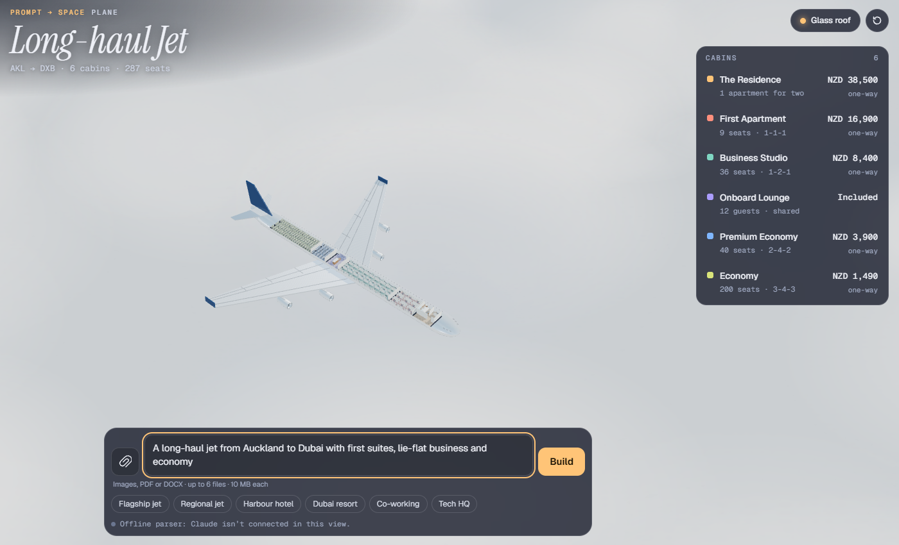

**2. The space is built**, with a glass shell so the zones show through and a price list on the right.

| Plane | Hotel | Office |
|---|---|---|
| 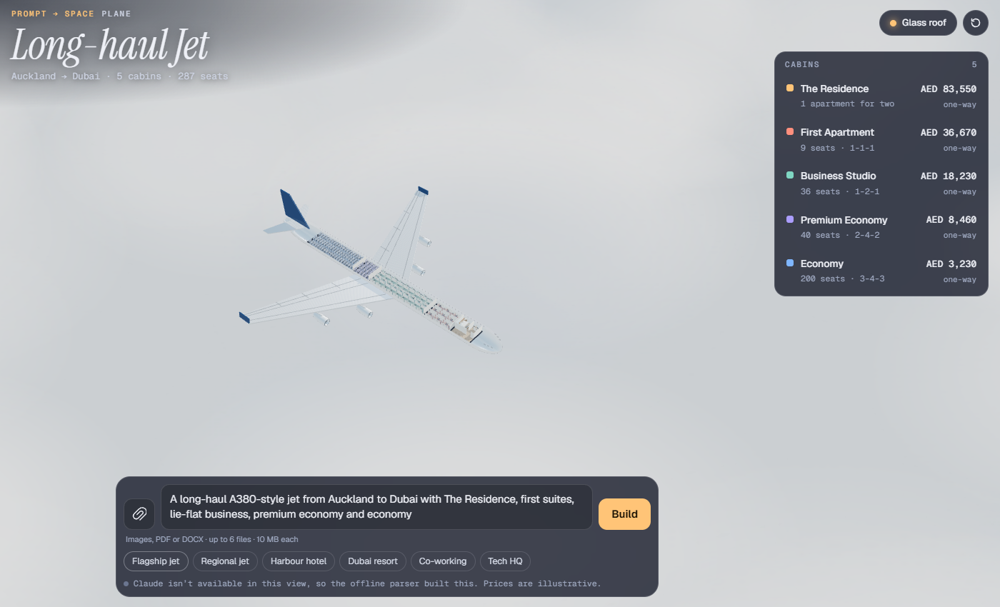 | 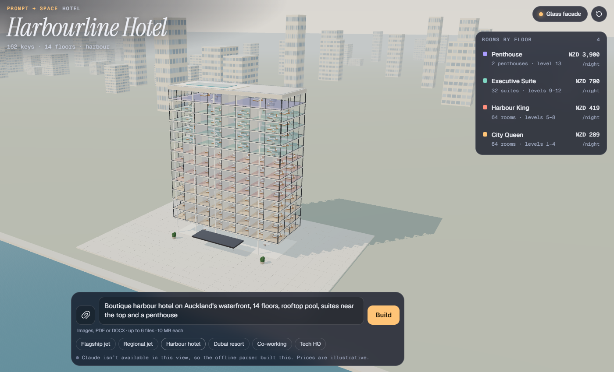 | 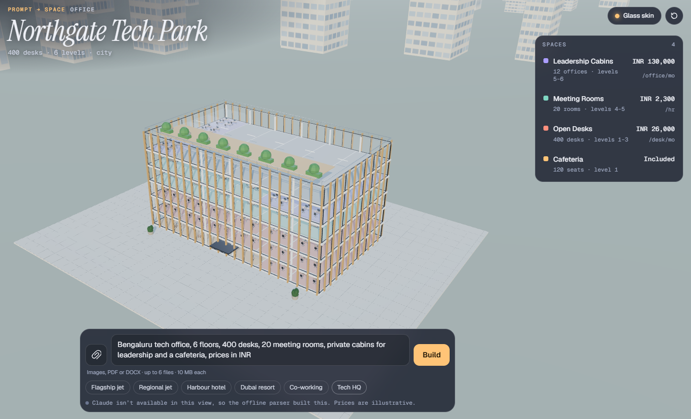 |

**Zoom in** (scroll or pinch) to look through the glass at the seats, rooms and desks inside.

| Plane cabins | Hotel rooms | Office floors |
|---|---|---|
| 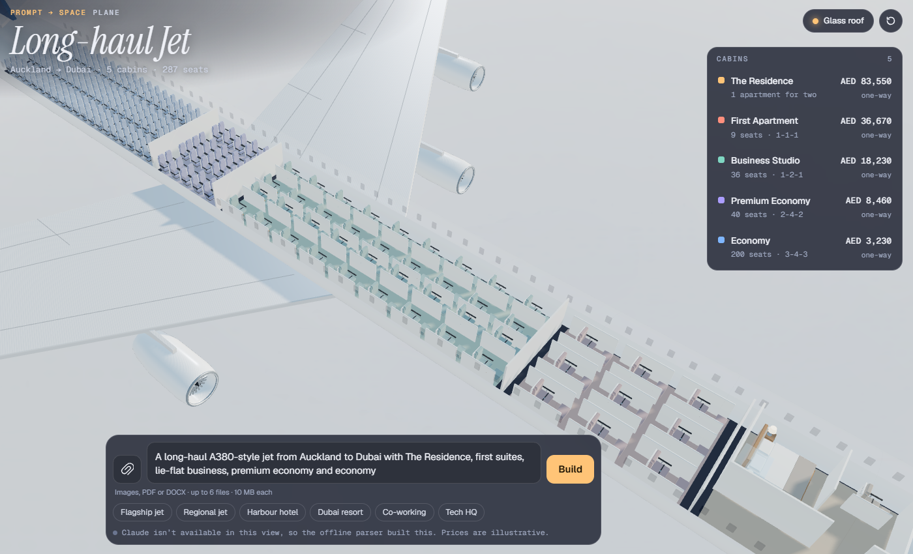 | 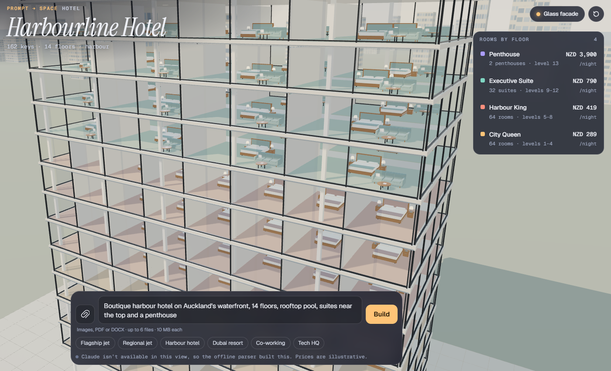 | 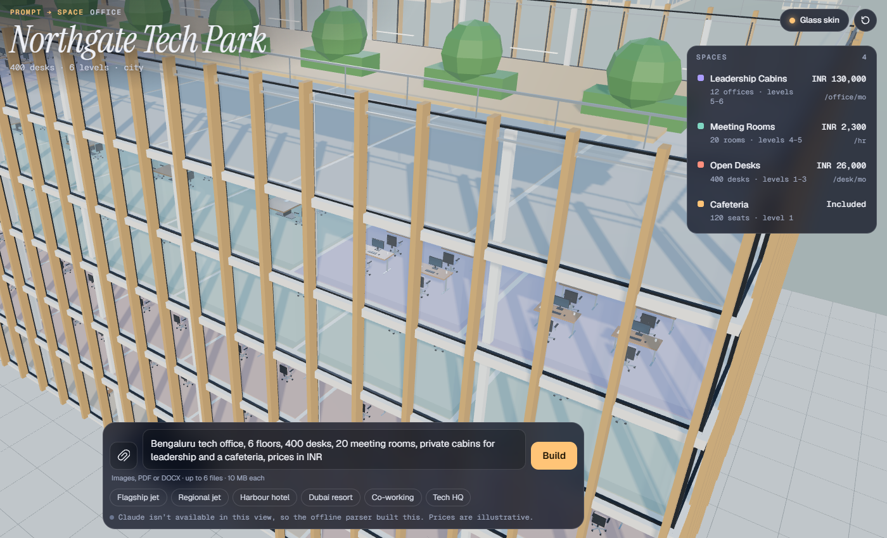 |

**3. Tap a zone** to light it up and see its price, capacity and features.

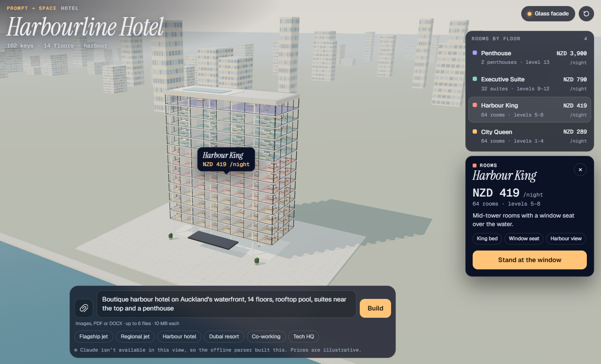

**Fly in** from any zone card to see the view from that seat, room, desk or balcony, then upgrade to the next zone up.

**4. Apartment valuations.** In the apartment development, every apartment is coloured by its latest valuation rate. Select one to see its valuation history, placement confidence and floor plan, or switch to **Select floor** for a level summary. The 3D chart plots every valuation by quarter and floor against a fitted trend surface. The valuations are generated demo data.

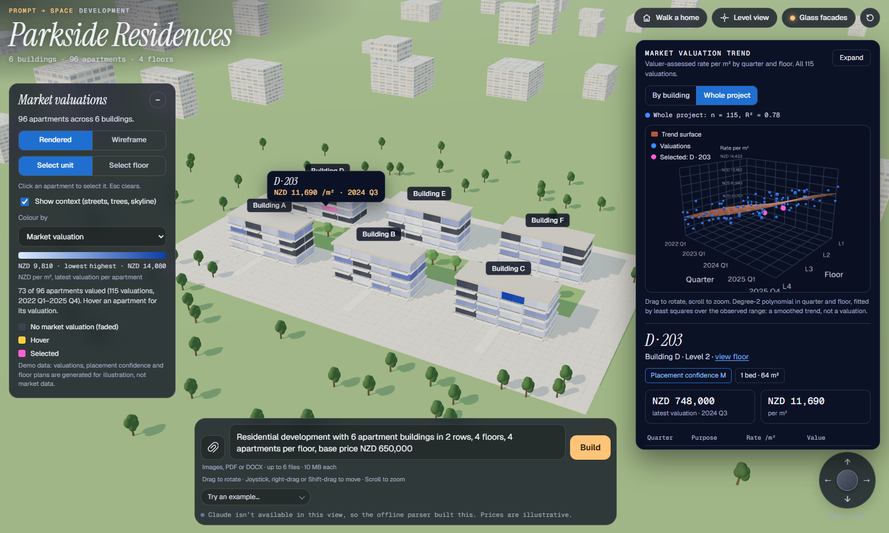

**5. Walk through a home.** **Walk a home** (top right) opens a furnished townhouse with real furniture, materials and sky photographs. Take the guided tour, walk room to room, switch to the dollhouse view, change the light and restyle the interior.

| Welcome | Inside |
|---|---|
| 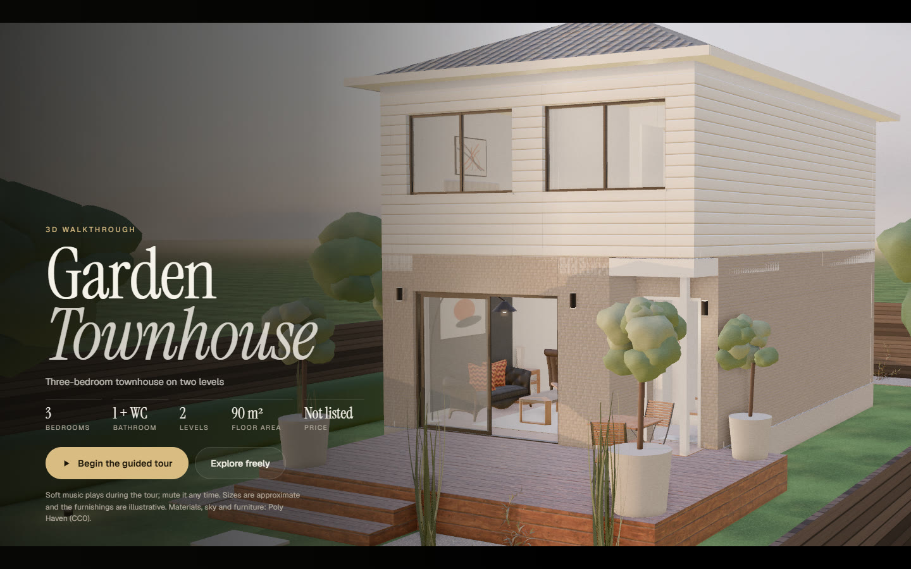 | 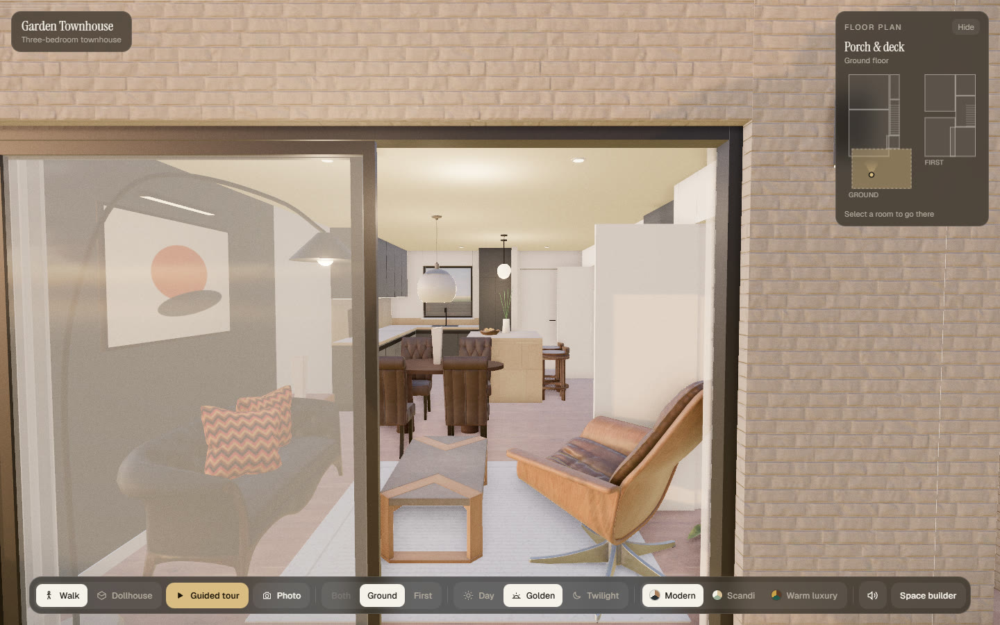 |

## Quick start

```bash
npm install          # esbuild + playwright (dev only)
npm run dev          # http://localhost:5173/
npm run build        # bundles src/ into dist/index.html (single file)
npm test             # smoke test + screenshots into docs/screenshots/
```

The first `npm test` needs a browser: `npx playwright install chromium`, or set `CHROME_PATH` to an installed Chrome. The test serves Three.js from `node_modules`. Without internet access, set `OFFLINE=1` so it skips Google Fonts (PowerShell: `$env:OFFLINE=1; npm test`).

### Using Claude locally

Outside a Claude artifact, the dev server's backend (`scripts/claude-api.mjs`) calls the Anthropic API instead:

1. `cp .env.example .env` and set `ANTHROPIC_API_KEY` (get one at https://console.anthropic.com).
2. `npm run dev`. The page checks `GET /api/health`; when a key is set, **Build** posts to `POST /api/layout` and Claude writes the layout.

Without a key the page falls back to the offline parser, as before.

### Build from reference files

Use the paperclip next to the prompt, drop files onto the prompt dock, or paste an image. Attach JPG, PNG, WebP, GIF, PDF or DOCX files, then add instructions and press **Build**. A document can supply the instructions by itself. Remove individual files with their × button.

Reference builds use the local Claude backend. PDFs are sent intact for text and visual analysis; DOCX files contribute their text and embedded raster images. Reference colors can control wood, upholstery, floors and walls. The result is an interpretation within the supported plane/hotel/office/stadium/development builders, not an exact mesh reconstruction.

Limits: 6 files, 10 MB per file, 20 MB total, 50 PDF pages and 24 images (including Word images). Standalone images are resized to a maximum edge of 1536 pixels. Password-protected PDFs and unsupported embedded Word images produce an error; export such Word documents as PDF. Attachments stay in page memory and are sent to Claude only on Build; refreshing clears them. Offline and artifact-only sessions do not silently substitute a text-only build for attachments.

Run `npm run test:references` for extraction, API and browser upload checks (mocked Claude; no API usage).

Opening `index.html` straight from disk won't work, because browsers block ES modules on `file://`. Use `npm run dev`.

## Tech stack

| Layer | Choice |
|---|---|
| Language | Vanilla JavaScript (ES2020 modules), HTML, CSS. No framework |
| 3D | [Three.js](https://threejs.org) 0.160.0 (WebGL), loaded from jsDelivr through an import map: `OrbitControls`, `BufferGeometryUtils`, image-based lighting from a procedural sky shader |
| AI | Claude, through the Claude artifact `sample` capability (`sample.json`, `quick` model tier) |
| Fallback | Keyword parser in the browser (`src/spec/offline-parser.js`) |
| Fonts | Instrument Serif, Geist, Geist Mono (Google Fonts) |
| Build | [esbuild](https://esbuild.github.io) 0.24.2: bundles `src/` into a single-file `dist/index.html` |
| Dev server | Node built-in `http` (`scripts/serve.mjs`), no dependencies |
| Tests | [Playwright](https://playwright.dev) 1.49.1 (Chromium) smoke test with a mocked Claude reply |
| Hosting | A Claude artifact (with Claude), or any static host (offline parser only) |

## Architecture

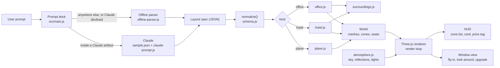

| Layer | Files | Responsibility |
|---|---|---|
| Prompt | `src/main.js`, `src/spec/claude-prompt.js`, `src/spec/offline-parser.js` | Takes the prompt and gets a layout spec from Claude, or from the parser when Claude isn't available |
| Contract | `src/spec/schema.js` | Defines the layout spec and presets; `normalize()` validates and clamps every field |
| Scene | `src/scene/*.js` | Turns a normalized spec into a world: geometry, zone hit volumes, price-tag anchors and window-seat positions |
| Shell | `src/main.js`, `src/styles.css` | Camera framing, glass toggle, picking, HUD, fly-in view, render loop |

## Where Claude comes in

The prompt step uses the Claude artifact `sample` capability (`claude.use("sample")`), so it only runs when the page is published as a Claude artifact.

- **As an artifact:** publish `dist/index.html` and declare `capabilities: { sample: {} }`. The first Build asks the viewer to allow it, and calls run on the viewer's own Claude usage.
- **Anywhere else** (local dev, any static host): Claude isn't available, so `src/spec/offline-parser.js` builds the layout from keywords in the prompt. Its prices are illustrative.

Three.js 0.160.0 loads from jsDelivr through the import map in `index.html`. There is no other runtime dependency.

## Project structure

```
3dspace/
├── index.html                  page markup, import map, entry point (dev)
├── src/
│   ├── main.js                 app shell: renderer, camera, HUD, picking, window view, prompt flow, render loop
│   ├── styles.css              HUD, zone card, prompt dock, window-view frames, phone layout
│   ├── util.js                 small shared helpers
│   ├── spec/
│   │   ├── schema.js           layout spec: types, presets, normalize()
│   │   ├── claude-prompt.js    the instruction sent to Claude
│   │   └── offline-parser.js   keyword fallback when Claude isn't available
│   └── scene/
│       ├── atmosphere.js       sky dome, sky-lit reflections, sun, per-kind palettes
│       ├── helpers.js          geometry, material and texture helpers
│       ├── plane.js            fuselage, wings, engines, cabins, cloud sea
│       ├── hotel.js            tower, floors per zone, rooms, roof amenities
│       ├── office.js           floor plates in bays, desks, glass rooms, fins
│       └── surroundings.js     ground, water, skyline, hills, trees
├── scripts/
│   ├── serve.mjs               zero-dependency static dev server
│   └── build.mjs               esbuild bundle into dist/index.html
├── tests/
│   └── smoke.mjs               Playwright walk-through, mocked Claude path, screenshots
├── dist/
│   └── index.html              single-file build (the published artifact)
└── docs/
    ├── layout-spec.md          the JSON contract in detail
    └── screenshots/
```

## How it works

```
prompt ──► Claude (sample.json) ──► layout spec (JSON) ──► normalize() ──► buildPlane / buildHotel / buildOffice ──► scene
              └── fallback: offlineSpec() ─────────┘
```

The layout spec is the only contract between the prompt step and the renderer. To swap the procedural geometry for real models (glTF), change `src/scene/*` and leave the rest alone. See [docs/layout-spec.md](docs/layout-spec.md).

## Not included

- Geometry is procedural (boxes, lathes and extrusions), not real aircraft or building models.
- There is no booking or payment flow.
